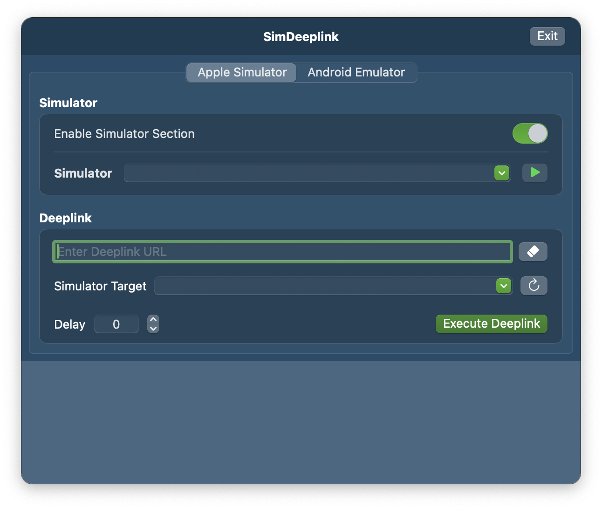
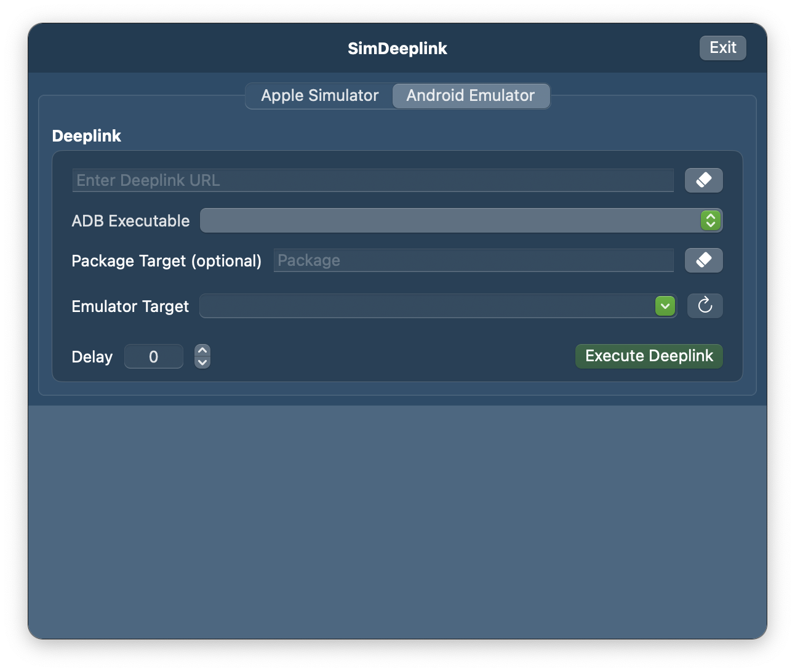

<p align="center">
  
</p>

# SimDeeplink (Menu Bar)


[](https://tauri.app)
[](https://github.com/alifu/SimDeeplink/releases)
[](./LICENSE)
[](https://github.com/alifu/SimDeeplink/releases)
[](https://github.com/alifu/homebrew-tap)


SimDeeplink (Deeplink Runner) is a desktop utility designed to make testing and running app deeplinks in Simulator effortless. Unlike other solutions, there’s no need to drag and drop URLs onto Simulator—you simply paste and run! The app lives comfortably in your macOS menu bar (or the Windows and Linux system tray), allowing quick access at any time.

| | iOS Simulator | Android Emulator |
|---|:---:|:---:|
| macOS | ✅ | ✅ |
| Windows | – | ✅ |
| Linux (Debian, Ubuntu, Fedora) | – | ✅ |

The iOS Simulator only exists on macOS, so Windows and Linux show the Android section alone.

|Apple Simulator|Android Emulator|
|:---:|:---:|
|||


## ✨ Features

- **Paste and Run Deeplinks Instantly:** Just paste your deeplink and run it in Simulator—no drag-and-drop required.
- **Delay:** Add delay to wait for the simulator to be ready to watch.
- **Specific Simulator Target:** Choose your right target for running deeplink.
- **Menu Bar Access:** Launch and use the app from your menu bar on any Mac desktop, for maximum convenience.
- **Simulator Booting:** The app can automatically boot the Simulator if it’s not running, so you can execute deeplinks immediately.

## 🧭 Install

### macOS

With [Homebrew](https://brew.sh) (no Xcode needed; this installs the prebuilt app):

```bash
brew install --cask alifu/tap/simdeeplink
```

Open it from Launchpad, Spotlight or `open -a SimDeeplink`; the icon appears in the menu bar.

```bash
brew update && brew upgrade --cask simdeeplink     # update
brew uninstall --cask simdeeplink                  # uninstall (add --zap to also remove its settings)
```

Or download `SimDeeplink.zip` from the [latest release](https://github.com/alifu/SimDeeplink/releases/latest), unzip it and
drag `SimDeeplink.app` into `/Applications`. To update that way, quit the app and replace it with the new one; to remove
it, quit it and move it to the Trash.

<details>
<summary><b>"SimDeeplink can't be opened" warning</b></summary>

SimDeeplink isn't notarized by Apple (that needs a paid developer account), so macOS blocks it the first time you open
it. You only have to allow it once:

1. Open SimDeeplink. macOS shows a warning that it couldn't verify the app; click **Done**.
2. Open **System Settings › Privacy & Security** and scroll down to the **Security** section.
3. Next to "SimDeeplink was blocked to protect your Mac", click **Open Anyway**, then confirm with your password or
   Touch ID and click **Open Anyway** again.

Or, from the Terminal, remove the quarantine flag instead:

```bash
xattr -dr com.apple.quarantine /Applications/SimDeeplink.app
```
</details>

### Windows

Download `SimDeeplink_X.Y.Z_x64-setup.exe` (or the `.msi`) from the
[latest release](https://github.com/alifu/SimDeeplink/releases/latest) and run it. The `.exe` installs for your user only
and needs no administrator rights. The icon appears in the system tray (click `^` if Windows hides it).

- **Update:** run the installer of the newer version; it replaces the old one.
- **Uninstall:** **Settings › Apps › Installed apps › SimDeeplink › Uninstall**.

<details>
<summary><b>"Windows protected your PC" warning</b></summary>

The installer isn't code-signed (that needs a paid certificate), so Microsoft Defender SmartScreen warns about it. Click
**More info**, then **Run anyway**. To check the download first, compare
`Get-FileHash .\SimDeeplink_X.Y.Z_x64-setup.exe` with `SHA256SUMS-windows.txt` on the release page.
</details>

### Linux (Debian, Ubuntu, Fedora)

Download the package for your distribution from the [latest release](https://github.com/alifu/SimDeeplink/releases/latest).
It was tested on Debian 12, Ubuntu 22.04 and 24.04, and Fedora 40 and 41.

| Distribution | Install | Update | Uninstall |
|---|---|---|---|
| Debian, Ubuntu | `sudo apt install ./SimDeeplink_X.Y.Z_amd64.deb` | install the newer `.deb` the same way | `sudo apt remove sim-deeplink` |
| Fedora | `sudo dnf install ./SimDeeplink-X.Y.Z-1.x86_64.rpm` | `sudo dnf upgrade ./SimDeeplink-X.Y.Z-1.x86_64.rpm` | `sudo dnf remove sim-deeplink` |

Start **SimDeeplink** from your application menu, or run `simdeeplink`. The icon appears in the system tray.

<details>
<summary><b>No tray icon on GNOME</b></summary>

GNOME (the default Ubuntu and Fedora desktop) doesn't show tray icons without an extension. Install
**AppIndicator and KStatusNotifierItem Support** (on Ubuntu it is already included) and log in again. Without a tray,
SimDeeplink opens as a normal window instead, so it still works. Wayland doesn't let apps place their own windows, so on
Linux the window opens in the middle of the screen instead of under the icon.
</details>

### Requirements

| | |
|---|---|
| macOS | macOS 14 or later. iOS simulators need Xcode (or the Command Line Tools). |
| Windows | Windows 10 or later with the WebView2 runtime (included in Windows 11 and current Windows 10). |
| Linux | A desktop with GTK 3 and WebKitGTK 4.1 (installed with the package). |
| Android (all systems) | The Android SDK platform-tools (`adb`) and, to start an emulator from the app, the `emulator` package. SimDeeplink looks in `ANDROID_HOME`, `ANDROID_SDK_ROOT`, the default Android Studio SDK folder and your `PATH`; if you have several, pick one in the **ADB Executable** list. |

### Build from source

Only needed to work on SimDeeplink itself; see [`DEVELOPMENT.md`](./DEVELOPMENT.md).

Maintainers: see [RELEASING.md](RELEASING.md).

## 💡 Why Use This?
- Eliminate repetitive drag-and-drop steps for deeplink testing.
- Stay focused—access the tool instantly from your menu bar.
- Works with any desktop setup.
- Streamlines the developer workflow, especially for QA and app review scenarios.

## 🧪 Roadmap

| Status | Feature |
|:-------:|-----|
|✅|**Running Deeplink:** Just paste the deeplink and GO!|
|✅|**Simulator Section:** Choose and boot the XCode Simulator without XCode (We can disabled this feature if no needed)|
|✅|**Add Timer for Deeplink Execution:** Allow users to specify a delay before running a deeplink, making it easier to wait for the simulator to be ready.|
|✅|**Distribute via Homebrew:** Publish the app through Homebrew for easy installation. Currently, run the project from source as described above.|
|✅|**Android Emulator Support:** Enable deeplink runs in Android Emulator for cross-platform testing.|
|✅|**MacOS App:** Build for MacOS (first in Swift/SwiftUI, kept on the [`legacy`](https://github.com/alifu/SimDeeplink/tree/legacy) branch; now Tauri).|
|✅|**Windows App:** Build for Windows (Using Tauri -- Rust and React). Android section only.|
|✅|**Linux App:** Build for Linux (Using Tauri -- Rust and React). Android section only; `.deb` and `.rpm`.|
|✅|**One app everywhere:** One Tauri app (Rust and React) for macOS, Windows and Linux.|

## ⚙️ Contributing
Contributions and feedback are welcome! Please open an issue or submit a pull request with ideas or improvements.

### 🚀 Getting Started

```bash
git clone https://github.com/alifu/SimDeeplink.git
cd SimDeeplink
npm ci
npm run tauri dev
```

Needs Node 22 and a current stable Rust (and, on Linux, the WebKitGTK and AppIndicator development packages). Tests,
project layout and how to build the installers: [`DEVELOPMENT.md`](./DEVELOPMENT.md). Maintainers: see
[`RELEASING.md`](./RELEASING.md) for how a release and the Homebrew cask are published.

## 🪪 License
MIT License. See [`LICENSE`](./LICENSE) for details.

---

> _Built with passion and love ❤️  
> — [@alifu](https://github.com/alifu)